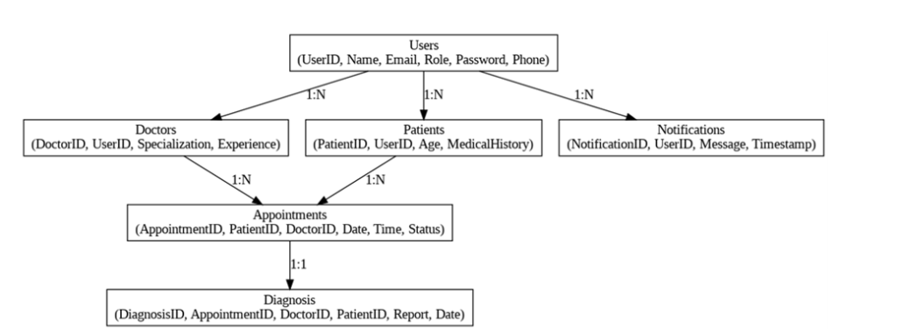
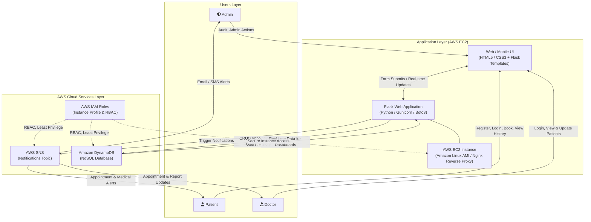
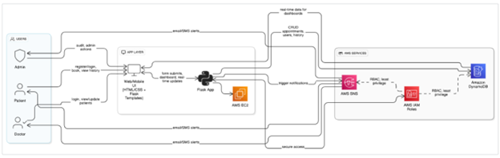
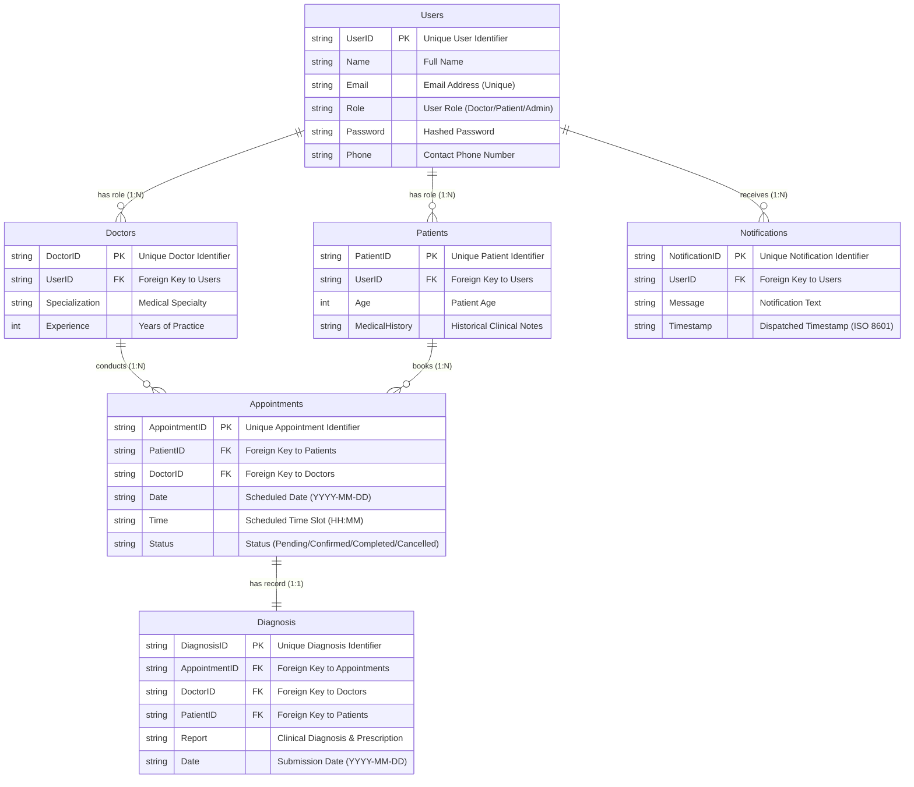

# MedTrack: Cloud-Based Healthcare Management System

## Executive Overview

In today’s fast-evolving healthcare landscape, efficient communication and coordination between doctors and patients are crucial. **MedTrack** is a robust, cloud-powered healthcare management platform designed to streamline patient–doctor interactions by providing a centralized platform for booking appointments, managing medical histories, and enabling diagnosis submissions.

The platform addresses critical operational bottlenecks in modern healthcare by leveraging **Flask** for backend development, **AWS EC2** for scalable cloud hosting, and **Amazon DynamoDB** for resilient, high-performance NoSQL data management. Real-time notifications powered by **AWS SNS** ensure seamless communication regarding appointment confirmations, schedule updates, and diagnostic reports. Security and compliance are strictly enforced through **AWS Identity and Access Management (IAM)**, granting least-privilege, role-based access control (RBAC) to protect sensitive patient health data.

---

## Key Project Scenarios

### Scenario 1: Efficient Appointment Booking System for Patients
AWS EC2 provides high-availability infrastructure capable of handling high concurrent patient traffic. Patients log in, navigate to the booking interface, and submit appointment requests with specialized doctors in real time. Flask orchestrates backend operations, validating time slots, saving records to DynamoDB, and triggering instant notification events via AWS SNS.

### Scenario 2: Secure User Management with IAM
MedTrack employs AWS IAM to enforce role-based access control and principle of least privilege. Patient accounts are restricted to personal appointment booking and historical health records. Doctor roles grant access to assigned patient records and diagnostic workflows. AWS IAM service roles and instance profiles ensure the EC2 application layer interacts securely with AWS DynamoDB and SNS without hardcoding sensitive credentials.

### Scenario 3: Easy Access to Medical History and Resources
Doctors and patients access comprehensive medical histories and diagnostic files on demand. When a doctor logs in, upcoming appointments and patient clinical backgrounds are retrieved in real time from DynamoDB. Diagnoses and clinical notes can be authored, uploaded, and linked directly to appointment records with instant status synchronization.

---

## Project Stats & Skills

### Project Statistics
| Metric | Value |
| :--- | :--- |
| **Total Epics** | 12 |
| **Total Tasks** | 18 |
| **Total Subtasks** | 0 |
| **Mentor Status** | No mentor assigned yet |
| **Target Career Roles** | Healthcare IT, Cloud Developer, Cloud Support Engineer |

### Core Skills & Technologies
- **Compute & Hosting:** AWS EC2, Amazon Linux AMI, Gunicorn, Nginx
- **Security & Access Control:** AWS Identity and Access Management (IAM), Security Groups, Least-Privilege RBAC
- **Database:** Amazon DynamoDB (NoSQL)
- **Networking:** Amazon Virtual Private Cloud (VPC), Amazon Route 53
- **Application Framework:** Flask (Python Web Framework), Jinja2 Templates
- **SDK & Messaging:** Boto3 (AWS SDK for Python), AWS Simple Notification Service (SNS)
- **Monitoring & Observability:** AWS CloudWatch (Logs, Metrics, Alarms)

---

## Technical Architecture

### Architecture Diagram



### Architectural Flowchart



### Component Breakdown
1. **Users Layer:**
   - **Admin:** Manages platform audit trails, user access verification, and administrative controls.
   - **Patient:** Handles self-registration, authentication, appointment scheduling, and personal medical history tracking.
   - **Doctor:** Manages clinical schedules, reviews patient medical backgrounds, and submits post-appointment diagnoses.
2. **App Layer (AWS EC2):**
   - **Web/Mobile UI:** Built with semantic HTML5, modern CSS, and Flask Jinja2 templates for responsive user experiences.
   - **Flask Backend:** Manages routing, session security, input validation, DynamoDB CRUD operations, and SNS dispatching.
   - **EC2 Instance:** Hosted on Amazon Linux, fronted by Nginx reverse proxy with Gunicorn WSGI workers.
3. **AWS Cloud Services:**
   - **AWS SNS:** Broadcasts real-time transactional SMS and email notifications upon appointment booking and diagnostic updates.
   - **Amazon DynamoDB:** Fully managed NoSQL key-value database providing single-digit millisecond latency for user profiles, appointments, and medical records.
   - **AWS IAM Roles:** Granular role definitions ensuring secure machine-to-machine and user-to-resource interactions.

---

## Dual-Mode Architecture: Local Mode vs. AWS Cloud Mode

MedTrack features an **adaptive dual-mode architecture**. If you do not have AWS credentials yet, the system runs in a **100% self-contained Local Mode**. The moment you configure AWS credentials, it **automatically switches** to live AWS services without requiring any code changes.

### Mode Comparison Matrix

| Component | Local Mode (No Credentials) | AWS Cloud Mode (Credentials Present) |
| :--- | :--- | :--- |
| **Trigger** | `AWS_ACCESS_KEY_ID` is empty / placeholder, or `AWS_MODE=local` | Valid AWS credentials in `.env`, environment, or EC2 IAM Role |
| **Database** | JSON-backed DynamoDB mock engine (`data/local_db.json`) | Live **Amazon DynamoDB** tables with Global Secondary Indexes |
| **Notifications** | Dispatches to console, logs to `data/sns_notifications.log`, & creates in-app alerts | Dispatches real-time SMS and email alerts via **AWS SNS** |
| **Dependencies** | Runs with pure standard libraries + Flask (no `boto3` crash) | Uses **Boto3** SDK to communicate with AWS APIs |
| **UI Indicator** | Amber `<span class="badge bg-warning">Local Mode</span>` badge | Green `<span class="badge bg-success">AWS Mode</span>` badge |
| **Health API** | `{"status": "healthy", "mode": "local", "aws_enabled": false}` | `{"status": "healthy", "mode": "aws", "aws_enabled": true}` |

### Ready-To-Use Local Test Accounts
When running in Local Mode, the database automatically initializes with sample seed records:
- **Administrator:** `admin@medtrack.com` / `Admin@12345` (Admin portal, audits, full records)
- **Doctor:** `doctor@medtrack.com` / `Doctor@12345` (Schedule, patient list, diagnosis portal)
- **Patient:** `patient@medtrack.com` / `Patient@12345` (Booking, medical history, notifications)

### How to Switch Between Modes
1. **To run locally (Default):**
   ```bash
   python run.py
   ```
   Open `http://localhost:5000` to immediately register, log in, book appointments, and write diagnoses.
2. **To switch to AWS Cloud:**
   Open `.env` and fill in your AWS credentials:
   ```env
   AWS_MODE=auto
   AWS_REGION=us-east-1
   AWS_ACCESS_KEY_ID=AKIA...
   AWS_SECRET_ACCESS_KEY=wJalr...
   ```
   Restart `run.py`. MedTrack detects the credentials and automatically connects to live AWS DynamoDB and SNS!

---

## Technical Implementation Instructions

### 1. Environment Setup & Cloud Configuration
- Provision Python 3.10+ virtual environment and install dependencies: `Flask`, `boto3`, `gunicorn`.
- Configure AWS credentials and region settings using AWS CLI.
- Set up an Amazon EC2 instance with Amazon Linux AMI inside an Amazon VPC.
- Attach an IAM Instance Profile to EC2 with explicit policies for DynamoDB read/write and SNS publish actions.

### 2. Cloud Database Design (Amazon DynamoDB)
- Model DynamoDB tables with dedicated Partition Keys (`PK`) and Sort Keys (`SK`):
  - `Users` (`UserID`)
  - `Doctors` (`DoctorID`, `UserID`)
  - `Patients` (`PatientID`, `UserID`)
  - `Appointments` (`AppointmentID`, `PatientID`, `DoctorID`)
  - `Diagnosis` (`DiagnosisID`, `AppointmentID`)
  - `Notifications` (`NotificationID`, `UserID`)
- Establish Global Secondary Indexes (GSIs) on foreign key attributes (`DoctorID`, `PatientID`, `UserID`) to support high-throughput lookups.

### 3. Building the Flask Application
- **Authentication & RBAC:** Implement session-based authentication separating Patient and Doctor roles.
- **Appointment Scheduling:** Build real-time calendar and time-slot booking forms preventing double bookings.
- **Diagnosis & Medical Submissions:** Create medical history viewer and diagnosis submission portals for verified physicians.
- **RESTful Endpoints:** Implement modular Flask blueprints (`auth`, `patient`, `doctor`, `admin`, `api`).

### 4. Cloud Notifications with AWS SNS
- Create Amazon SNS Standard Topics (e.g., `MedTrack-Appointment-Alerts`, `MedTrack-Diagnosis-Updates`).
- Implement Boto3 SNS client triggers within Flask routes upon successful booking or diagnostic submission.
- Enable email and SMS protocol subscriptions for automated alert delivery.

### 5. Secure Access Control with IAM
- Construct IAM policies adhering to least privilege:
  - Policy for EC2 instance role allowing only `dynamodb:GetItem`, `dynamodb:PutItem`, `dynamodb:UpdateItem`, `dynamodb:Query` and `sns:Publish`.
- Prevent exposure of AWS access keys by utilizing instance metadata service (IMDSv2).

### 6. Deployment on AWS EC2
- Configure Nginx as a reverse proxy listening on port 80/443, forwarding traffic to Gunicorn listening on unix sockets or localhost.
- Configure Systemd service units to supervise Gunicorn processes with automatic restarts.
- Bind security groups allowing inbound HTTP/HTTPS (80/443) and SSH (22) from authorized management IPs.

### 7. Testing & Validation
- Execute end-to-end integration tests for user registration, login, appointment booking, diagnosis submission, and SNS notifications.
- Perform concurrent user simulations to validate DynamoDB capacity modes (On-Demand vs. Provisioned) and EC2 CPU/memory utilization.

### 8. Monitoring & Optimization
- Stream application logs and Nginx access/error logs to AWS CloudWatch Logs.
- Configure CloudWatch Alarms for EC2 CPU utilization (>75%), 5xx HTTP response codes, and DynamoDB throttling events.

---

## Entity-Relationship (ER) Diagram & Data Model

An **Entity-Relationship (ER) diagram** visually represents the logical structure of a database by defining entities, their attributes, and relationships. This structured approach supports database normalization, data integrity, and efficient query design.

### ER Diagram



### Logical ER Model



---

## Database Schema & Entity Specifications

### 1. Entities & Primary Keys
| Entity | Primary Key (PK) | Description |
| :--- | :--- | :--- |
| **Users** | `UserID` | Core user identity for authentication and profile management |
| **Doctors** | `DoctorID` | Professional clinical metadata for licensed doctors |
| **Patients** | `PatientID` | Clinical metadata and medical background for patients |
| **Appointments** | `AppointmentID` | Scheduled consultation sessions between doctor and patient |
| **Diagnosis** | `DiagnosisID` | Clinical findings, diagnostic reports, and prescriptions |
| **Notifications**| `NotificationID` | Dispatched transactional messages and alerts |

### 2. Entity Attributes

#### Users
- `UserID` (PK): Unique identifier (UUID/string)
- `Name`: Full legal name
- `Email`: Email address (used as login username)
- `Role`: User system role (`Doctor`, `Patient`, `Admin`)
- `Password`: Securely salted and hashed password
- `Phone`: Contact phone number for SMS notifications

#### Doctors
- `DoctorID` (PK): Unique identifier for doctor profile
- `UserID` (FK): Reference to associated `Users` record
- `Specialization`: Medical field (e.g., Cardiology, Dermatology, General Practice)
- `Experience`: Years of medical experience

#### Patients
- `PatientID` (PK): Unique identifier for patient profile
- `UserID` (FK): Reference to associated `Users` record
- `Age`: Age of patient
- `MedicalHistory`: Baseline medical conditions, allergies, and past surgeries

#### Appointments
- `AppointmentID` (PK): Unique identifier for appointment
- `PatientID` (FK): Reference to `Patients` entity
- `DoctorID` (FK): Reference to `Doctors` entity
- `Date`: Date of scheduled consultation
- `Time`: Time slot of consultation
- `Status`: Current state (`Pending`, `Confirmed`, `Completed`, `Cancelled`)

#### Diagnosis
- `DiagnosisID` (PK): Unique identifier for diagnostic report
- `AppointmentID` (FK): One-to-one reference to consultation session
- `DoctorID` (FK): Reference to attending physician
- `PatientID` (FK): Reference to patient recipient
- `Report`: Medical findings, lab reviews, and prescription details
- `Date`: Date of diagnostic report submission

#### Notifications
- `NotificationID` (PK): Unique identifier for notification
- `UserID` (FK): Recipient user reference
- `Message`: Content of the notification alert
- `Timestamp`: UTC timestamp of generation and dispatch

### 3. Entity Relationships & Cardinality
- **Users to Doctors, Patients, Notifications (1:N):** One user identity links to specific role profiles and can accumulate multiple notification logs.
- **Doctors to Appointments (1:N):** A doctor conducts multiple appointments across time slots.
- **Patients to Appointments (1:N):** A patient can schedule multiple appointments with different doctors.
- **Appointments to Diagnosis (1:1):** Each appointment generates exactly one official diagnostic record, ensuring 1:1 referential integrity.

### 4. Normalization and Structural Integrity
The schema is normalized to eliminate data redundancy and prevent update/delete anomalies:
- Distinct entities separate identity (`Users`), clinical qualifications (`Doctors`), and personal health records (`Patients`).
- Transactional interactions (`Appointments`, `Diagnosis`, `Notifications`) reference primary keys as foreign keys, maintaining referential integrity across relational or NoSQL DynamoDB table structures.

### 5. Use Case Coverage
- **Role-Based Access Control:** Strict division between patient features and physician workflows.
- **Lifecycle Appointment Tracking:** Full visibility over appointment state changes from booking to completion.
- **Secure Medical Records Management:** Confidential diagnostic reporting tied directly to validated appointments.
- **Real-Time Automated Alerting:** SNS triggers informing patients and doctors of schedule confirmations and diagnostic availability.

---

## Project Learning Outcomes
By completing the MedTrack platform, developers and engineers demonstrate:
1. Building secure, enterprise-grade healthcare applications using **Flask** and **Python**.
2. Designing scalable, normalized cloud databases on **Amazon DynamoDB**.
3. Applying **AWS IAM** policies and roles for HIPAA-aligned least-privilege security.
4. Implementing real-time event-driven messaging using **AWS SNS**.
5. Deploying, hardening, and monitoring production workloads on **AWS EC2** with **CloudWatch**.
