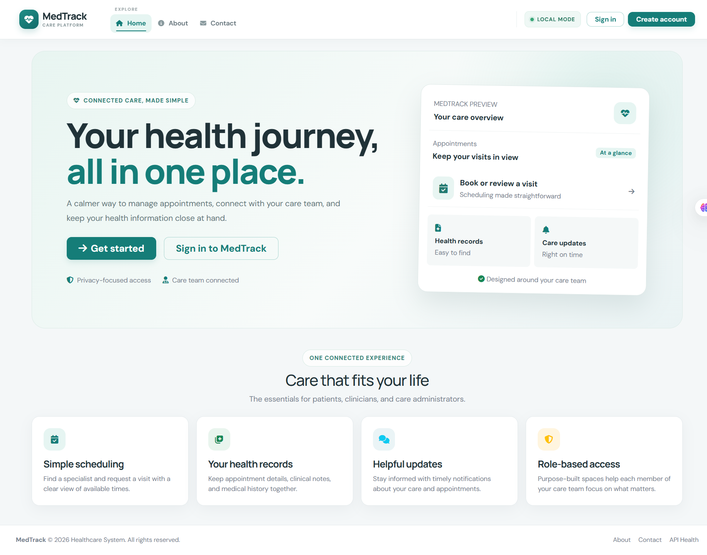
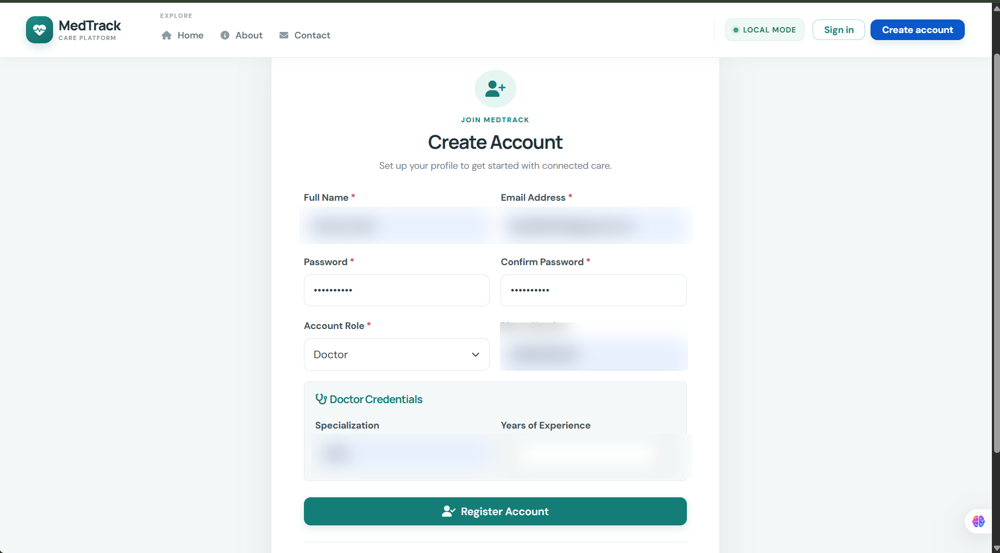
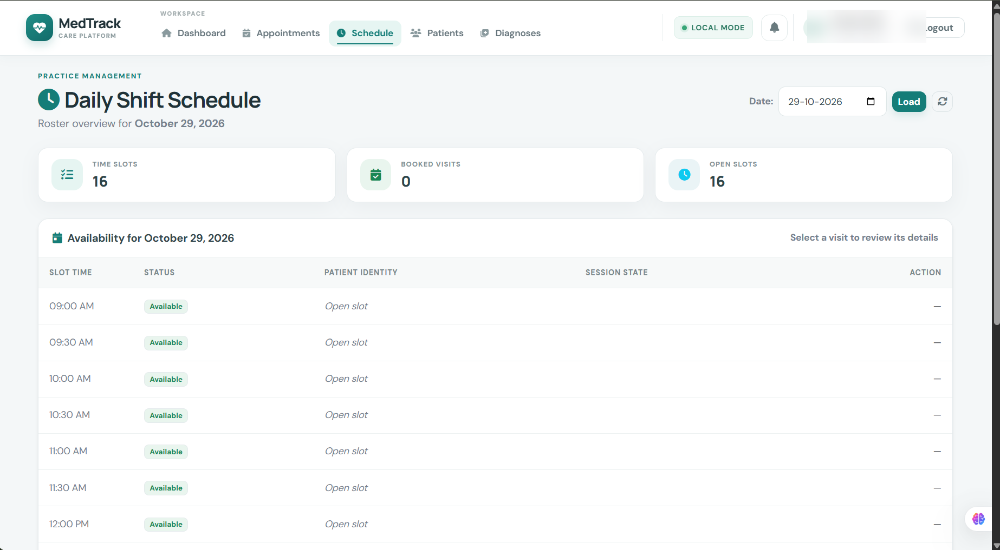
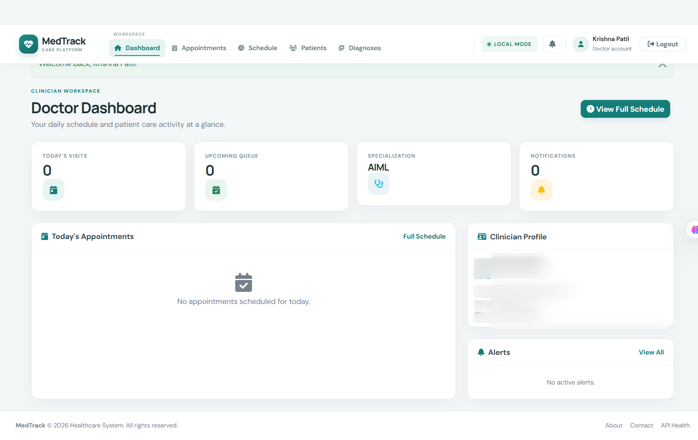
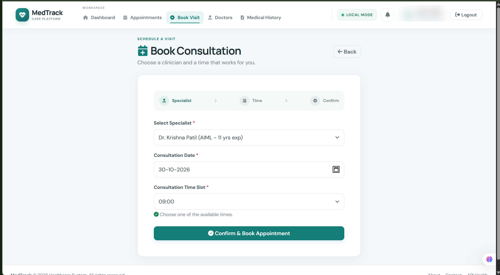
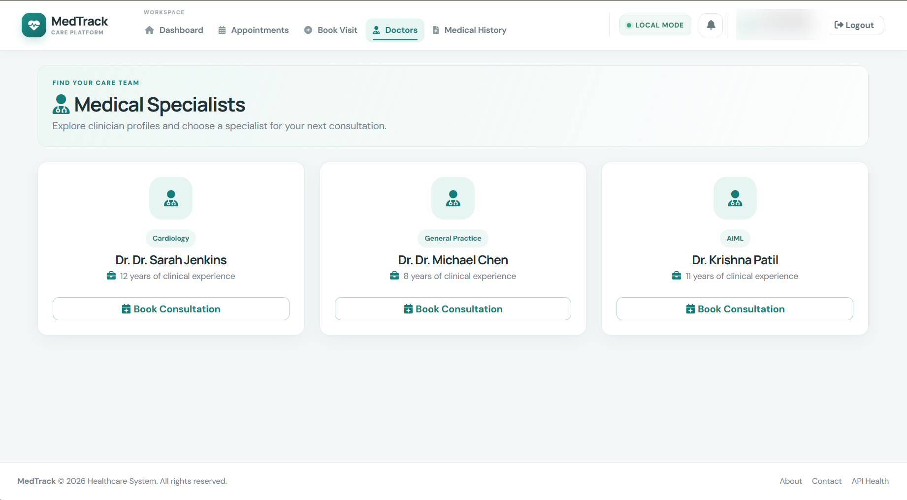
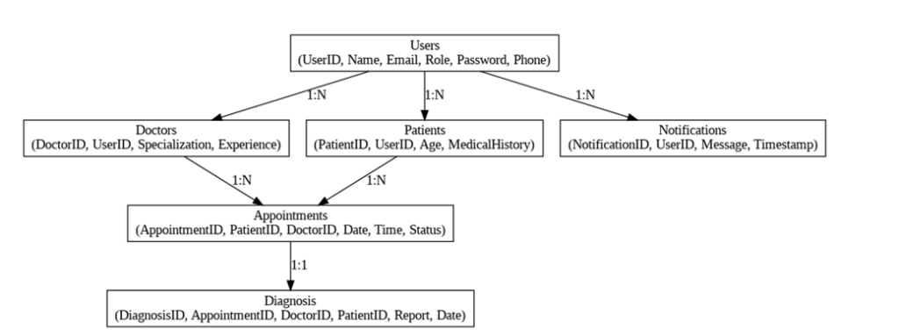
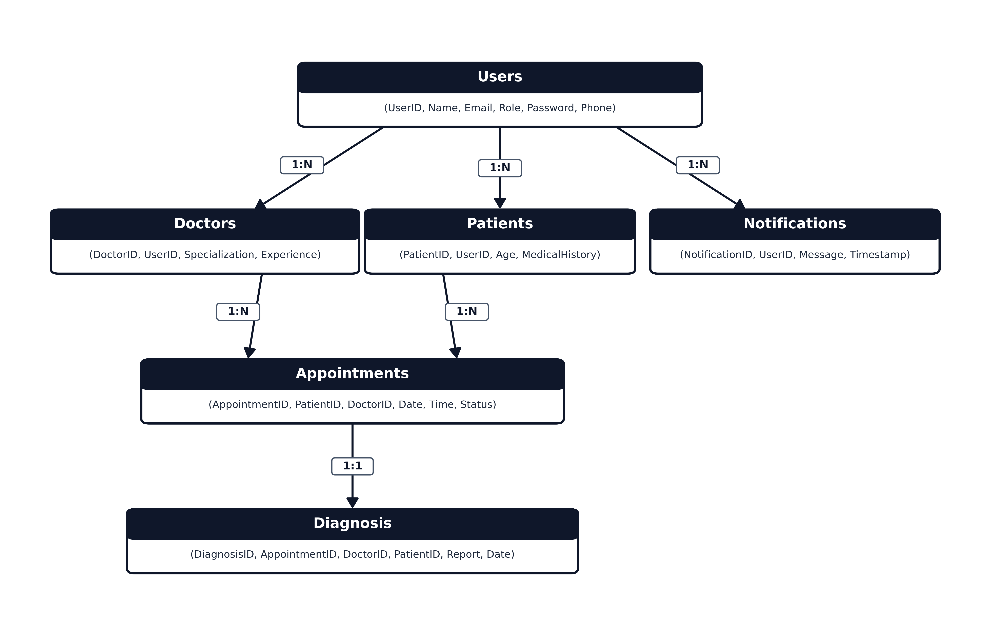

# MedTrack — Healthcare Management System

MedTrack is a Flask web application for patient and clinician workflows. Patients can create accounts, find doctors, book appointments, and review medical history. Doctors can manage schedules, review appointments, and submit diagnosis reports. The application supports local development and AWS-backed operation with DynamoDB and SNS.

## Live Demo and Project Materials

| Resource | Link |
| --- | --- |
| AWS EC2 deployment | [Open MedTrack](http://3.94.64.130:5000/) |
| Render deployment | [Open MedTrack on Render](https://medtrack-aws-healthcare-system.onrender.com) |
| Walkthrough video | [Watch the demo](https://drive.google.com/file/d/1B_X2V7ITx84ZhDU0fs945yEgdlitlXAb/view?usp=sharing) |
| Project report | [Download the project documentation](docs/MedTrack_Project_Documentation.docx) |
| Deployment instructions | [Read DEPLOYMENT.md](DEPLOYMENT.md) |

## Features

- Patient and doctor registration and sign-in, with role-based pages.
- Doctor directory and appointment booking with available time slots.
- Doctor schedule and appointment status management.
- Patient medical history and doctor-submitted diagnosis reports.
- In-app notifications and optional AWS SNS topic publishing.
- Local mode for development and AWS mode for DynamoDB/SNS deployments.

## Screenshots

### Home page


### Create account


### Doctor schedule


### Doctor dashboard


### Patient appointment booking


### Patient doctor directory


## Technology

- **Application:** Python, Flask, Jinja templates
- **AWS integrations:** Amazon DynamoDB, Amazon SNS, Boto3, EC2 instance role credentials
- **Local development:** JSON-backed local storage; optional Docker Compose services

## Run Locally

Requires Python 3.10 or later.

```bash
git clone https://github.com/Krishna009-pro/medtrack-aws-healthcare-system.git
cd medtrack-aws-healthcare-system
python3 -m venv .venv
source .venv/bin/activate
pip install -r requirements.txt
AWS_MODE=local python app.py
```

Open [http://localhost:5000](http://localhost:5000). Local mode uses the local data adapter and does not send messages to AWS SNS.

On Windows PowerShell, use:

```powershell
git clone https://github.com/Krishna009-pro/medtrack-aws-healthcare-system.git
cd medtrack-aws-healthcare-system
python -m venv .venv
.venv\Scripts\Activate.ps1
pip install -r requirements.txt
$env:AWS_MODE = "local"
python app.py
```

## AWS Deployment Notes

For an EC2 deployment, attach an IAM instance profile to the instance. Boto3 then obtains temporary credentials from the role; do not put AWS access keys in the app’s `.env` file. Set the region and SNS topic ARN in the environment before starting the app:

```bash
export AWS_MODE=auto
export AWS_DEFAULT_REGION=us-east-1
export SNS_TOPIC_ARN='arn:aws:sns:us-east-1:ACCOUNT_ID:TOPIC_NAME'
export FLASK_DEBUG=False
export SECRET_KEY='use-a-long-random-secret'
```

Create the DynamoDB tables once, using a role with `dynamodb:CreateTable`, then start the app:

```bash
python3 scripts/init_dynamodb.py
python3 app.py
```

The EC2 runtime role must allow the app’s required DynamoDB actions and `sns:Publish` on the configured topic. SNS email subscribers must confirm their subscription before receiving email. The application only publishes to the configured topic when a supported event occurs, such as appointment booking, confirmation/cancellation, or diagnosis submission. See [DEPLOYMENT.md](DEPLOYMENT.md) for IAM, systemd, Gunicorn, and Nginx details.

> The EC2 and Render URLs above are included as provided project links. Availability depends on their hosting configuration.

## Architecture





## Project Structure

```text
app/                  Flask app, routes, models, templates, and services
scripts/              Database initialization utilities
docs/                 Project report and web screenshots
images/               Architecture and data model diagrams
DEPLOYMENT.md         AWS deployment guide
requirements.txt      Python dependencies
```

## License

No license file is currently included. Contact the repository owner for reuse or distribution permissions.
