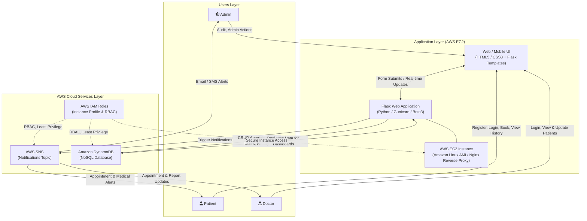
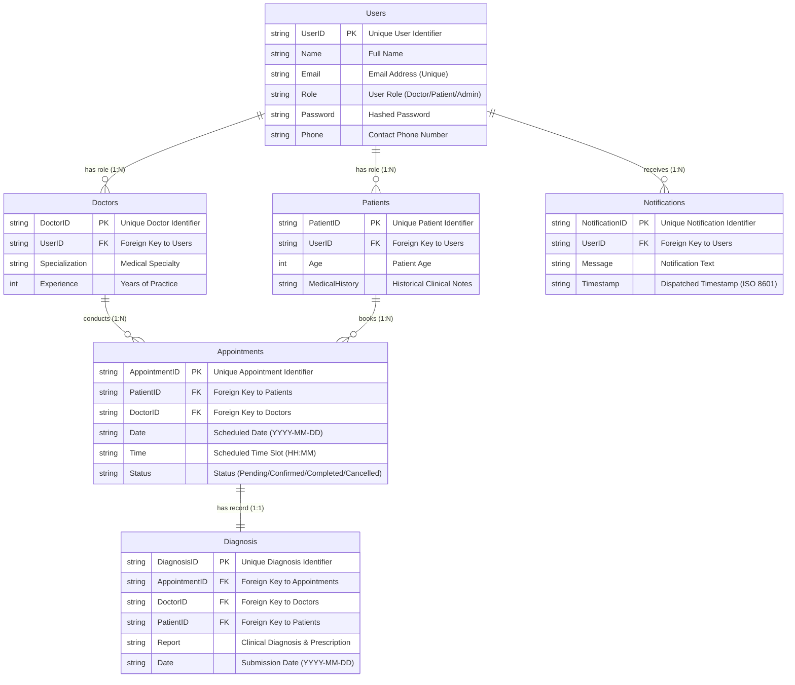

# MedTrack: Cloud-Based Healthcare Management System
## System Architecture & Technical Specification

## 1. Executive Overview

In today’s fast-evolving healthcare landscape, efficient communication and coordination between doctors and patients are crucial. **MedTrack** is a cloud-based healthcare management system designed to streamline patient–doctor interactions by providing a centralized platform for booking appointments, managing medical histories, and enabling diagnosis submissions.

The project utilizes **Flask** for backend development, **AWS EC2** for cloud hosting, and **Amazon DynamoDB** for scalable, high-performance data management. Real-time notifications powered by **AWS SNS** enhance communication between doctors and patients regarding appointments and medical submissions. Additionally, **AWS Identity and Access Management (IAM)** enforces secure access control to AWS resources, ensuring only authorized users access sensitive clinical data.

---

## 2. Core Scenarios

### Scenario 1: Efficient Appointment Booking System for Patients
AWS EC2 provides a reliable infrastructure to manage multiple patients accessing the platform simultaneously. For example, a patient can log in, navigate to the appointment booking page, and easily submit a request for an appointment. Flask handles backend operations, efficiently retrieving and processing user data in real time. The cloud-based architecture allows the platform to handle a high volume of appointment requests during peak periods, ensuring smooth operation without delays.

### Scenario 2: Secure User Management with IAM
MedTrack utilizes AWS IAM to manage user permissions and ensure secure access to the system. For instance, when a new patient registers, an IAM user or role is associated with specific permissions to access only the features relevant to them. Doctors have their own IAM configurations, allowing them access to patient records and appointment details while maintaining strict security protocols. This setup ensures that sensitive data is accessible only to authorized users.

### Scenario 3: Easy Access to Medical History and Resources
The MedTrack system provides doctors and patients with easy access to medical histories and relevant resources. For example, a doctor logs in to view a patient's medical history and upcoming appointments. They can quickly access and update records as needed. Flask manages real-time data fetching from DynamoDB, while EC2 hosting ensures the platform performs seamlessly even when multiple users access it simultaneously, offering a smooth and uninterrupted user experience.

---

## 3. Skills Required & Project Stats

### Skills Required
- **AWS EC2** (Elastic Compute Cloud)
- **AWS Identity And Access Management (IAM)**
- **Amazon DynamoDB** (NoSQL Database)
- **Amazon Virtual Private Cloud (VPC)**
- **Flask** (Python Web Framework)
- **AWS CloudWatch** (Monitoring & Logging)
- **Amazon Linux Amazon Machine Image (AMI)**
- **Amazon Route 53** (DNS & Traffic Routing)
- **AWS SNS** (Simple Notification Service)
- **Boto3** (AWS SDK for Python)
- **Nginx & Gunicorn** (Production Web Hosting)

### Project Stats
- **Epics:** Total Epics: 12
- **Stories & Tasks:** Total Tasks: 18
- **Subtasks:** Total Subtasks: 0
- **Mentor:** No mentor assigned yet
- **Target Career Roles:** Healthcare IT, Cloud Developer, Cloud Support Engineer

---

## 4. Technical Architecture

### Architecture Diagram


### System Architecture Flowchart


### Architecture Description
- **Users Layer:** Admin (audit and management), Patient (registration, booking, medical history), Doctor (consultation, records, diagnosis).
- **App Layer:** Web/Mobile UI (HTML/CSS + Flask Templates) interacting with the Flask application hosted on an AWS EC2 instance running Amazon Linux, managed via Gunicorn and Nginx.
- **AWS Services Layer:**
  - **AWS SNS:** Triggers email/SMS notifications to patients, doctors, and admins.
  - **Amazon DynamoDB:** Handles real-time CRUD operations for appointments, users, and clinical history.
  - **AWS IAM Roles:** Enforces role-based access control (RBAC) and least privilege for secure cloud access.

---

## Dual-Mode Architecture: Local Mode vs. AWS Cloud Mode

MedTrack features an adaptive dual-mode architecture. If Boto3 cannot find AWS credentials, the system runs in Local Mode. When Boto3 finds credentials in its standard provider chain, including an EC2 instance profile, `AWS_MODE=auto` selects live AWS services. No static access keys need to be stored on EC2.

### Mode Comparison Matrix

| Component | Local Mode (No Credentials) | AWS Cloud Mode (Credentials Present) |
| :--- | :--- | :--- |
| **Trigger** | `AWS_MODE=local`, or Boto3 finds no credentials | Boto3 provider chain finds credentials, including an EC2 IAM instance profile |
| **Database** | JSON-backed DynamoDB mock engine (`data/local_db.json`) | Live **Amazon DynamoDB** tables with Global Secondary Indexes |
| **Notifications** | Dispatches to console, logs to `data/sns_notifications.log`, & creates in-app alerts | Dispatches real-time SMS and email alerts via **AWS SNS** |
| **Dependencies** | Runs with pure standard libraries + Flask (no `boto3` crash) | Uses **Boto3** SDK to communicate with AWS APIs |
| **UI Indicator** | Amber `<span class="badge bg-warning">Local Mode</span>` badge | Green `<span class="badge bg-success">AWS Mode</span>` badge |
| **Health API** | `{"status": "healthy", "mode": "local", "aws_enabled": false}` | `{"status": "healthy", "mode": "aws", "aws_enabled": true}` |

### EC2 Setup Without Access Keys

Attach an IAM role to the EC2 instance. Boto3 retrieves and refreshes temporary credentials from EC2 instance metadata; do not add access keys to `.env` or source code. Set the following non-secret configuration in the shell or systemd environment:

```bash
export AWS_MODE=auto
export AWS_DEFAULT_REGION=us-east-1
export SNS_TOPIC_ARN=arn:aws:sns:us-east-1:ACCOUNT_ID:MedTrack-Alerts
export FLASK_ENV=production
export FLASK_DEBUG=False
export SECRET_KEY='replace-with-a-long-random-production-secret'

# Run once to create the required DynamoDB tables and GSIs
python scripts/init_dynamodb.py

# Start the Flask web server
python app.py
```

`AWS_REGION` is also supported and takes precedence over `AWS_DEFAULT_REGION`. A single SNS topic can be configured with `SNS_TOPIC_ARN`; separate appointment and diagnosis topics are preferred. The instance role needs access to the configured DynamoDB tables and `sns:Publish` for the SNS topic ARNs. Create the DynamoDB tables and GSIs once with `python scripts/init_dynamodb.py` under a setup role that has `dynamodb:CreateTable`; `app.py` does not create them.

### Ready-To-Use Local Test Accounts
When running in Local Mode, the database automatically initializes with sample seed records:
- **Administrator:** `admin@medtrack.com` / `Admin@12345` (Admin portal, audits, full records)
- **Doctor:** `doctor@medtrack.com` / `Doctor@12345` (Schedule, patient list, diagnosis portal)
- **Patient:** `patient@medtrack.com` / `Patient@12345` (Booking, medical history, notifications)

---

## 5. Technical Implementation Instructions

### 1. Environment Setup & Cloud Configuration
- Set up your development environment with Flask, Gunicorn, and `boto3`.
- Configure EC2, IAM roles, and secure AWS access for cloud operations.

### 2. Designing the Cloud Database
- Use DynamoDB to store patient data, doctor profiles, appointments, and diagnosis records.
- Model tables with keys like `PatientID`, `DoctorID`, and `AppointmentID` for fast access.

### 3. Building the Flask Application
- Develop core healthcare workflows including:
  - Patient Registration & Login
  - Doctor Login with Role-Based Access
  - Appointment Booking & Scheduling
  - Diagnosis Uploads and Report Submission
  - Medical History Viewing for Patients & Doctors
- Master routing, sessions, and secure data interactions.

### 4. Implementing Cloud Notifications
- Use AWS SNS to send appointment confirmations, reminders, and diagnosis updates.
- Trigger notifications from Flask after any booking or medical submission.

### 5. Secure Access Control with IAM
- Configure IAM to restrict access to sensitive healthcare data.
- Patients and doctors receive permissions based on roles and responsibilities.

### 6. Deployment on AWS EC2
- Deploy MedTrack to EC2, using Gunicorn and Nginx for production hosting.
- Configure dependencies, security groups, and environment variables.

### 7. Testing & Validation
- Test appointment booking, report uploads, dashboards, and notifications end-to-end.
- Simulate multiple users to ensure performance, accuracy, and reliability.

### 8. Monitoring & Optimization
- Use CloudWatch for logs, metrics, and performance insights.
- Optimize queries, permissions, and EC2 resource usage.

---

## 6. Entity-Relationship (ER) Diagram & Schema

An **ER (Entity-Relationship) diagram** visually represents the logical structure of a database by defining entities, their attributes, and the relationships between them. It helps organize data efficiently by illustrating how different components of the system interact and relate. This structured approach supports effective database normalization, data integrity, and simplified query design.

### ER Diagram


### ER Diagram Model


### 1. Entities Involved
The ER diagram features six primary entities:
1. **Users**
2. **Doctors**
3. **Patients**
4. **Appointments**
5. **Diagnosis**
6. **Notifications**

### 2. Primary Keys
Each entity is uniquely identified by its primary key:
- **Users:** `UserID`
- **Doctors:** `DoctorID`
- **Patients:** `PatientID`
- **Appointments:** `AppointmentID`
- **Diagnosis:** `DiagnosisID`
- **Notifications:** `NotificationID`

### 3. Relationships
- **Users to Doctors/Patients/Notifications:** One user can be associated with multiple doctors (as a role), patients, and notifications (1 to Many).
- **Doctors to Appointments:** A doctor can have multiple appointments (1 to Many).
- **Patients to Appointments:** A patient can have multiple appointments (1 to Many).
- **Appointments to Diagnosis:** Each appointment is linked with one diagnosis, establishing a one-to-one relationship.

### 4. Foreign Keys
- **Doctors** and **Patients** reference **Users** via `UserID`.
- **Appointments** includes `PatientID` and `DoctorID` as foreign keys.
- **Diagnosis** references `AppointmentID`, `DoctorID`, and `PatientID` as foreign keys.
- **Notifications** links to **Users** via `UserID`.

### 5. Entity Attributes

#### Users Attributes
- `UserID` (PK)
- `Name`
- `Email`
- `Role`
- `Password`
- `Phone`

#### Doctors Attributes
- `DoctorID` (PK)
- `UserID` (FK)
- `Specialization`
- `Experience`

#### Patients Attributes
- `PatientID` (PK)
- `UserID` (FK)
- `Age`
- `MedicalHistory`

#### Appointments Attributes
- `AppointmentID` (PK)
- `PatientID` (FK)
- `DoctorID` (FK)
- `Date`
- `Time`
- `Status`

#### Diagnosis Attributes
- `DiagnosisID` (PK)
- `AppointmentID` (FK)
- `DoctorID` (FK)
- `PatientID` (FK)
- `Report`
- `Date`

#### Notifications Attributes
- `NotificationID` (PK)
- `UserID` (FK)
- `Message`
- `Timestamp`

### 6. Cardinality
- A single user may be a doctor or patient and can receive multiple notifications.
- Each doctor or patient can participate in multiple appointments.
- Each appointment has only one linked diagnosis.

### 7. Normalization and Structure
The diagram is normalized: data for users, doctors, patients, appointments, diagnoses, and notifications is stored in separate entities, reducing redundancy and ensuring clear data relationships.

### 8. Use Case Coverage
This ER model supports these core MedTrack healthcare management features:
- Role-based user management (doctor/patient distinction)
- Recording and tracking of appointments, status, and associated diagnosis reports
- Secure, detailed user and patient data handling
- Real-time notifications for appointment reminders or updates

---

## 7. Outcome & Career Alignment
By completing this project, developers will:
- Build a secure healthcare management system using **Flask** and **AWS**
- Implement **IAM-based access control** for sensitive data
- Deploy and monitor a real-time app on **EC2** with **Gunicorn** and **Nginx**
- Use **SNS** for automated healthcare notifications
- Manage scalable medical records with **DynamoDB**

*A complete cloud lifecycle experience ideal for Healthcare IT, Cloud Developer, and Cloud Support roles.*
